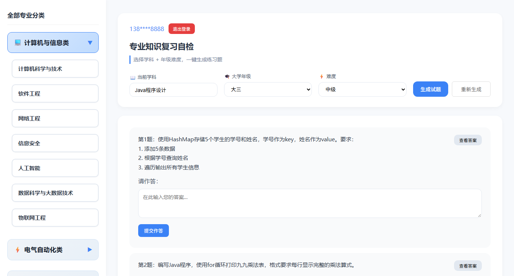

# 专业知识复习自检 · AI 驱动的在线刷题系统

一个面向计算机专业学生的刷题自检工具：选择学科与难度后自动生成练习题，
可查看分步解析与完整答案，并对错题进行记录和统计。

## 界面预览

**登录 / 注册**（手机号 + 密码，含表单校验与错误提示）


**刷题主界面**（左侧专业分类，右侧选择学科与难度，一键生成试题，支持作答与查看答案）



---

## 技术栈

| 层次 | 技术 |
| --- | --- |
| 前端 | 原生 JavaScript（单页应用）+ HTML5 + CSS3 |
| 后端 | Node.js + Express 5 |
| 网络请求 | axios |
| 配置管理 | dotenv |
| AI 能力 | DeepSeek 大模型 API（deepseek-chat） |

## 核心功能

1. **AI 动态出题**：针对非计算机类学科，调用 DeepSeek API 按知识点与难度生成 8 道题目，
   通过 prompt 约束模型输出「纯 JSON + 分步解析 + 完整答案」的结构，保证前端可稳定解析。
2. **三层降级策略**：
   - 第一层：内置题库（10 个学科 / 160 道题），计算机类学科直接命中，不走 API；
   - 第二层：内置题库未覆盖的学科，调用 DeepSeek API 生成；
   - 第三层：API 超时或异常时，自动切换到本地备用题库，保证页面不空白。
3. **用户体系**：注册 / 登录接口，手机号格式校验与脱敏显示。
4. **学习辅助**：错题记录、解析展开、做题统计。

## 常见问题排查

| 现象 | 原因 | 处理 |
| --- | --- | --- |
| 提示「AI 出题服务不可用（账户余额不足）」 | DeepSeek 账户余额为 0，接口返回 402 | 充值，或直接使用覆盖 44 个学科的本地题库 |
| 提示「账户余额不足」但提示语针对某学科 | 该学科既无本地题库、AI 又不可用 | 换用本地题库已覆盖的学科 |
| 页面能打开但**所有按钮没反应** | 前端脚本存在语法错误，整个 `script.js` 未执行 | 打开控制台查看 `SyntaxError`；本项目曾因题库数据被截断（对象未闭合）导致该问题，已修复 |
| 页面白屏、提示找不到页面 | 后端静态目录写成了本机绝对路径 | 已改为 `path.join(__dirname, '..', 'frontend')`，换机器也能跑 |

> 接口失败原因会在后端统一翻译：`402 余额不足`、`401 Key 无效`、`429 频率超限`、`超时`、`网络不可达`，
> 并随降级响应一并返回给前端展示。

## 接口设计

| 方法 | 路径 | 说明 |
| --- | --- | --- |
| POST | `/api/register` | 用户注册 |
| POST | `/api/login` | 用户登录 |
| POST | `/api/getQuestion` | 取题（本地题库 / AI 生成 / 备用题库） |

## 目录结构

```
backend/
├── server.js          服务端主程序（接口 + 题库 + AI 调用）
├── test-api.js        接口测试脚本
├── package.json
└── .env.example       环境变量示例（真实 .env 不入库）
frontend/
├── index.html         单页应用入口
├── script.js          前端逻辑
├── style.css          样式
└── img/               图标资源
```

## 本地运行

```bash
cd backend
npm install

# 配置密钥
copy .env.example .env    # Windows
# 然后编辑 .env，填入自己的 DEEPSEEK_API_KEY

node server.js
# 浏览器打开 http://127.0.0.1:5000
```

> ⚠️ `.env` 已加入 `.gitignore`，API 密钥不会进入仓库。
